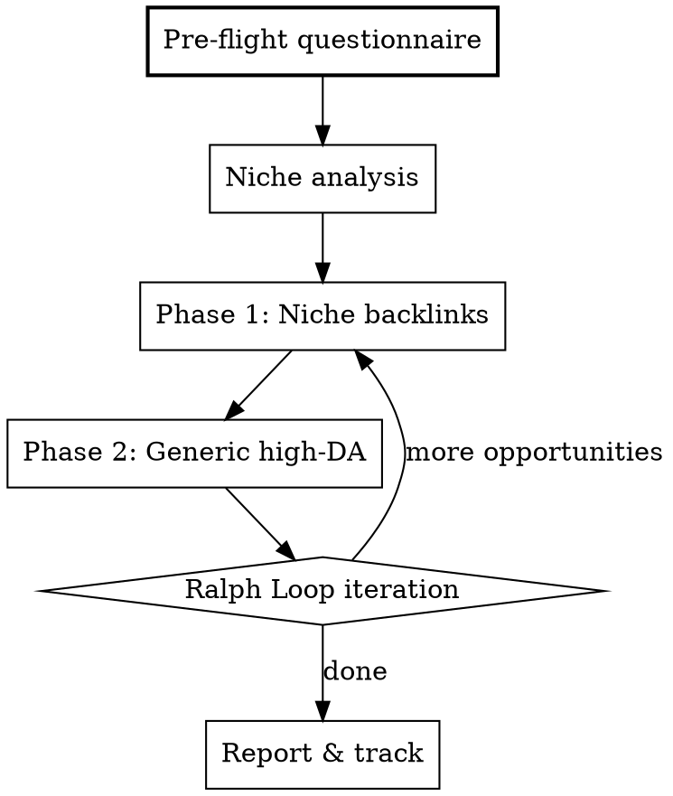

# Backlink Blitz

Automated backlink acquisition engine. Given a domain, identifies niche-relevant and generic high-authority opportunities, creates accounts via Playwright + temp-mail, and deposits quality backlinks with semantic content.

## STOP — Pre-Flight Questionnaire

**Before ANY automation starts (before ralph-loop, before subagents), you MUST collect answers to ALL of these:**

```
1. DOMAIN: What is the exact domain? (e.g., example.com)
2. NICHE: What is the niche/industry? (e.g., travel, SaaS, real estate, health, fintech)
3. PAGES: List the pages you want backlinks pointing to (homepage, /pricing, /blog/article-x...)
4. ANCHORS: Preferred anchor texts per page (e.g., "best travel agency in Paris", "book hotel online")
5. BRAND NAME: Exact brand name for profiles
6. DESCRIPTION: 2-3 sentence brand description (for profiles/bios)
7. LANGUAGE: Primary content language (fr, en, es...)
8. EXCLUSIONS: Any platforms to skip? (e.g., "already have LinkedIn")
9. PACE: Aggressive (all at once) or safe (spread over 2-3 weeks)?
10. CONTENT STYLE: Tone for generated articles (professional, casual, technical...)
```

**Do NOT proceed until all 10 are answered.** If user skips some, ask again. These answers feed every subagent.

## Architecture



## Phase 0 — Niche Analysis

After questionnaire, analyze the domain:

1. **Fetch the domain** with WebFetch — understand what they sell/do
2. **Map niche keywords** — extract 10-15 semantic keywords from the site
3. **Identify niche platforms** — which backlink sites from the database match this niche?

### Niche-to-Platform Mapping

| Niche | Priority Platforms |
|-------|-------------------|
| **Travel/Hotel** | Google Business, Apple Maps, Yelp, TripAdvisor, Trustpilot, Pinterest (travel boards), YouTube (destination video), Medium (travel blog), Substack (travel newsletter) |
| **SaaS/Tech** | G2, Capterra, GetApp, Software Advice, Product Hunt, AlternativeTo, GitHub, npm, VS Code Marketplace, Zapier, StackShare, dev.to, Hashnode, HackerNews |
| **Real Estate** | Zillow, Houzz, Google Business, Yelp, Pinterest (home decor), YouTube, Trustpilot |
| **E-commerce** | Google Business, Trustpilot, Pinterest, YouTube, Gumroad, AppSumo |
| **Health/Wellness** | Google Business, Yelp, Trustpilot, YouTube, Medium, Quora |
| **Agency/Consulting** | Clutch, ProvenExpert, Google Business, Crunchbase, LinkedIn, Wellfound, About.me |
| **AI/ML** | Hugging Face, Kaggle, Product Hunt, FutureTools, ListMyAI, dev.to, GitHub |
| **Creative/Design** | Behance, Dribbble, 500px, Figma Community, CodePen, Canva |
| **Finance/Fintech** | Crunchbase, G2, Trustpilot, LinkedIn, Product Hunt |
| **Education** | Medium, Substack, YouTube, Quora, SlideShare, Hashnode |

**If niche not listed:** Use WebSearch to find `"{niche}" + "submit your site"` or `"{niche}" + "free listing"` or `"{niche}" + "directory"`.

## Phase 1 — Niche-Specific Backlinks

Dispatch parallel subagents, one per platform cluster. Each subagent gets:

```markdown
## Subagent Prompt Template (Niche)

You are a backlink depositor. Your mission:

**Domain:** {domain}
**Brand:** {brand_name}
**Niche:** {niche}
**Target page:** {page_url}
**Anchor text:** {anchor}
**Language:** {language}
**Tone:** {content_style}
**Description:** {brand_description}

### Your platforms:
{list of 3-5 niche-relevant platforms}

### For EACH platform:

1. Navigate to the platform with Playwright (browser_navigate)
2. If account needed:
   a. Go to temp-mail.org → get a temporary email
   b. Sign up on the platform with that email
   c. Check temp-mail.org for verification email
   d. Click verification link
3. Fill profile COMPLETELY:
   - Name: {brand_name}
   - Bio/Description: {brand_description} (adapt to platform constraints)
   - Website URL: {page_url}
   - Social links if fields exist
   - Profile photo: upload brand logo if possible
4. If platform supports content (blog, article, review):
   - Write 300-500 word article relevant to {niche}
   - Naturally include {anchor} linking to {page_url}
   - Content must be UNIQUE, topically relevant, and well-structured
   - DO NOT stuff keywords — write for humans first
5. Take a screenshot of the completed profile/page as proof
6. Return: platform, URL of backlink, DoFollow/NoFollow, DA, status (success/failed/pending)

### Content Quality Rules:
- Every article must have: H2 headings, introduction, body, conclusion
- Anchor text must appear naturally in context, NOT forced
- Content must provide genuine value to readers of that platform
- Vary anchor text across platforms (exact match, partial match, branded, generic)
- NEVER use: "click here", "visit website", or naked URLs as anchor text in articles
```

### Subagent Grouping (dispatch in parallel):

- **Subagent A**: Profile-only platforms (LinkedIn, YouTube, GitHub, Gravatar, About.me)
- **Subagent B**: Review/listing platforms (Trustpilot, G2, ProvenExpert, Capterra)
- **Subagent C**: Content platforms (WordPress.com, Medium, Substack, Hashnode, dev.to)
- **Subagent D**: Niche-specific directories (based on niche analysis)
- **Subagent E**: Social platforms (Pinterest, Reddit, TikTok)

## Phase 2 — Generic High-Authority Backlinks

After niche backlinks, target universal high-DA sites. Refer to `backlinks-guide.md` for the full database.

### Priority Order (by DA and effort/impact ratio):

**Tier 1 — Quick Wins (5-15 min each, DA 82+):**
1. WordPress.com blog + article (DA 95, DoFollow)
2. Gravatar profile (DA 93, DoFollow)
3. GitHub profile + repo with README (DA 96, DoFollow)
4. Substack newsletter (DA 88, DoFollow)
5. About.me page (DA 88, DoFollow)
6. Hashnode blog (DA 82, DoFollow)
7. CodePen profile (DA 82, DoFollow)
8. Ko-fi page (DA 72, DoFollow)

**Tier 2 — Medium Effort (15-30 min, DA 80+):**
1. SlideShare presentation (DA 91, DoFollow)
2. Blogger.com blog (DA 91, DoFollow)
3. Issuu PDF/brochure (DA 93, DoFollow)
4. Vimeo profile (DA 92, DoFollow)
5. Crunchbase company profile (DA 89, DoFollow)
6. Behance portfolio (DA 89, DoFollow)
7. Product Hunt listing (DA 91, DoFollow)

**Tier 3 — High-Value NoFollow (brand signals):**
1. LinkedIn profile + company page (DA 99)
2. YouTube channel (DA 99)
3. Google Business Profile (DA 97+)
4. Pinterest business (DA 94)
5. Quora answers (DA 93)
6. Reddit posts (DA 92)

## Playwright Automation Patterns

### Temp-Mail Flow
```
1. browser_navigate → https://temp-mail.org/
2. browser_snapshot → copy the generated email address
3. Store email for later verification checks
4. After signup on target platform:
   - browser_navigate → back to temp-mail.org
   - browser_snapshot → look for verification email
   - browser_click → open email
   - browser_click → click verification link
```

### Common Signup Pattern
```
1. browser_navigate → platform signup page
2. browser_fill_form → email (from temp-mail), password, name
3. browser_click → submit
4. Handle CAPTCHA: if detected, SKIP platform and log it (don't waste time)
5. Verify email via temp-mail flow
6. browser_navigate → profile/settings page
7. browser_fill_form → bio, website URL, description
8. browser_click → save
9. browser_take_screenshot → proof
```

### Content Posting Pattern
```
1. browser_navigate → new post/article page
2. browser_fill_form → title (niche-relevant, SEO-friendly)
3. browser_fill_form → body (300-500 words, with natural backlink)
4. browser_click → publish
5. browser_snapshot → verify published
6. browser_take_screenshot → proof
```

## Content Generation Rules

**EVERY backlink with content must follow these rules:**

1. **Unique per platform** — never duplicate content across sites
2. **Topically relevant** — content matches both the niche AND the platform's audience
3. **Natural link placement** — the backlink appears in context, as a natural reference
4. **Semantic richness** — use LSI keywords, entities, and related terms
5. **Value-first** — the content should genuinely help readers, the link is secondary
6. **Proper formatting** — headings, paragraphs, lists where appropriate
7. **Varied anchors** — distribute across these types:
   - 30% branded anchors ("Brand Name")
   - 30% partial match ("Brand Name travel deals")
   - 20% exact match keyword ("best hotels in Paris")
   - 10% generic ("learn more", "this guide")
   - 10% naked URL ("example.com")

### Content Templates by Platform Type

**Blog platforms (WordPress, Medium, Substack, Hashnode):**
- 400-600 word article
- Title: "[Niche Topic]: [Value Proposition or How-To]"
- Structure: Intro → 2-3 H2 sections → Conclusion with CTA
- Link placement: naturally in body, within a relevant paragraph

**Profile platforms (GitHub, About.me, Gravatar):**
- Complete bio with brand description
- Website URL in designated field
- Social links where available

**Review/Directory platforms (G2, Capterra, ProvenExpert):**
- Complete company description
- Category selection (accurate, not spammy)
- Screenshots/media if supported

**Forum/Q&A platforms (Quora, Reddit):**
- Answer genuine questions in the niche
- Provide real value before linking
- Link only when contextually relevant
- NEVER spam links in responses

## Ralph Loop Integration

After Phase 1 and Phase 2, start ralph-loop to:

1. **Check results** — which platforms succeeded, which failed?
2. **Retry failures** — CAPTCHA cleared? Account verified?
3. **Find new opportunities** — WebSearch for more niche directories
4. **Monitor indexation** — check if Google has indexed the backlink pages
5. **Content improvement** — upgrade thin profiles with better content

**Ralph loop prompt:**
```
Review the backlink campaign for {domain}. Check the tracking file at backlink-blitz-{domain}-tracking.md.
For each FAILED entry, retry. For each SUCCESS, verify the link is still live.
Then search for 5 more niche-relevant platforms not yet covered.
Deposit backlinks on any new platforms found.
Update the tracking file.
```

## Tracking File

Create `backlink-blitz-{domain}-tracking.md` in the project root:

```markdown
# Backlink Campaign — {domain}
Generated: {date}

## Config
- Niche: {niche}
- Brand: {brand_name}
- Target pages: {pages}
- Anchors: {anchors}

## Results

| # | Platform | DA | DoFollow | URL | Anchor Used | Type | Status | Indexed | Date |
|---|----------|----|----------|-----|-------------|------|--------|---------|------|
| 1 | WordPress.com | 95 | Yes | https://... | "brand travel" | Article | OK | Yes | 2026-03-26 |
| 2 | GitHub | 96 | Yes | https://... | "Brand Name" | Profile | Pending | 2026-03-26 |
| ... | | | | | | | | | |

## Failed (to retry)

| Platform | Reason | Retry? |
|----------|--------|--------|
| G2 | CAPTCHA | Next iteration |

## Content Created

| Platform | Title | Words | Link |
|----------|-------|-------|------|
| WordPress.com | "Top 10 Hotels in..." | 450 | https://... |
```

## Phase 3 — Indexation Verification

After depositing backlinks, verify they're live and crawlable:

1. **Check each URL** — browser_navigate to the backlink URL, verify the link is visible
2. **Google index check** — WebSearch `site:{backlink-url}` to see if indexed
3. **If not indexed after 7 days** — ping via Google Search Console URL inspection or share the link on social media to trigger crawl
4. **Update tracking file** — add "Indexed: Yes/No" column

## Error Handling & Fallbacks

### Temp-Mail Blocked
Many platforms reject disposable emails. Fallback order:
1. Try temp-mail.org first (fastest)
2. If rejected, try guerrillamail.com or 10minutemail.com
3. If all temp-mails blocked, **SKIP the platform and log it** — don't ask user for personal email
4. Flag in tracking: "Needs real email" for user to complete manually

### Playwright Failures
| Issue | Action |
|-------|--------|
| CAPTCHA detected | Skip, log "CAPTCHA", move to next platform |
| Element not found | Take snapshot, try alternative selectors, skip if stuck > 2 min |
| Rate limited / IP blocked | Wait 30s, retry once, then skip |
| Signup form changed | Take screenshot for user, log "UI changed", skip |
| Timeout (> 60s on any page) | Skip, log "Timeout" |

**Rule: Never spend more than 5 minutes on a single platform.** Move on.

### DoFollow Priority

When time is limited, prioritize in this order:
1. DoFollow + high DA (WordPress.com DA95, GitHub DA96, Gravatar DA93)
2. DoFollow + medium DA (Hashnode DA82, CodePen DA82, About.me DA88)
3. NoFollow + very high DA (LinkedIn DA99, YouTube DA99 — brand signals)
4. DoFollow + low DA (Ko-fi DA72, BetaList DA72)

## Safety & Best Practices

1. **Pace control** — If user chose "safe", space out 3-5 profiles per day max
2. **No duplicate content** — every article must be unique
3. **Skip CAPTCHAs** — don't waste time, log and move on
4. **No black hat** — no PBNs, no link farms, no hidden text
5. **Complete profiles** — Google doesn't index empty profiles
6. **Real content** — 300+ words minimum on content platforms
7. **Anchor diversity** — follow the 30/30/20/10/10 distribution
8. **Save credentials** — log email/password combos used (in tracking file, NOT committed to git)
9. **DoFollow first** — always prioritize DoFollow links over NoFollow when choosing order
10. **Verify before reporting** — take screenshot proof of every deposited backlink

## Quick Reference

| Phase | Action | Subagents | Tools |
|-------|--------|-----------|-------|
| 0 | Questionnaire | None | AskUserQuestion |
| 0.5 | Niche analysis | 1 | WebFetch, WebSearch |
| 1 | Niche backlinks | 3-5 parallel | Playwright, temp-mail |
| 2 | Generic high-DA | 3-5 parallel | Playwright, temp-mail |
| 3 | Ralph loop | 1 (iterating) | All above |

## Common Mistakes

| Mistake | Fix |
|---------|-----|
| Starting without questionnaire | ALWAYS collect all 10 answers first |
| Duplicate content across platforms | Generate unique content per platform |
| All exact-match anchors | Follow 30/30/20/10/10 distribution |
| Empty/incomplete profiles | Fill EVERY field — Google skips empty profiles |
| Rushing 50 profiles in 1 day | Spread over 2-3 weeks if "safe" mode |
| Ignoring CAPTCHA failures | Log and retry next iteration, don't block |
| Posting thin content | 300+ words minimum, with real value |
| Not tracking results | Always update the tracking file |
